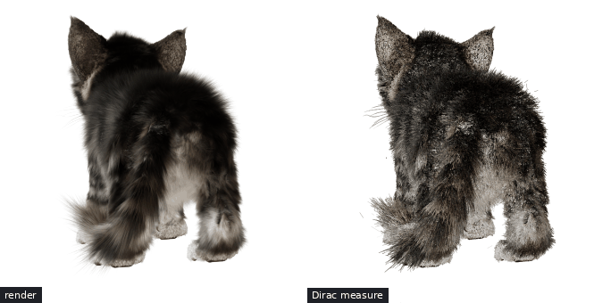
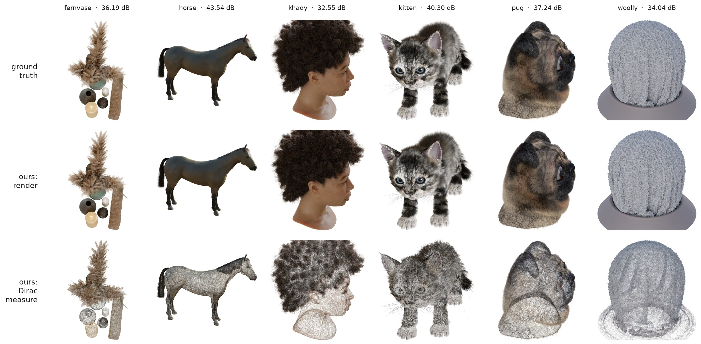
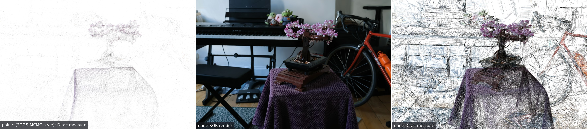
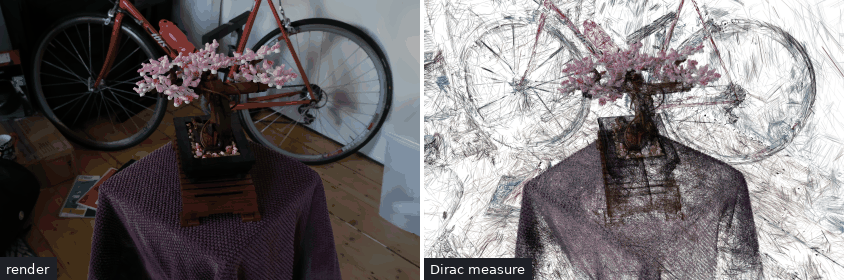
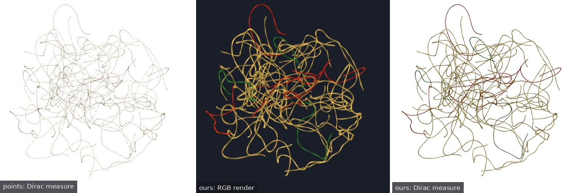

<div align="center">

# 🍝 Spaghetti Splatting (Unofficial)

**Unofficial PyTorch / CUDA implementation of**<br>
***Spaghetti Splatting: Differentiating Curvilinear Dirac Masses via Convolution***<br>
<sub>George Shramko, Shrisudhan Govindarajan, Rudy Lam, Yizheng Xie, Daniel Rebain, David B. Lindell, Andrea Tagliasacchi</sub>

[](LICENSE)


 

<sub>Orbits around two Shelly scenes. Left half of each: RGB render. Right half: the Dirac measure of the
primitives, every segment drawn as a thin line in its own colour.</sub>

</div>

> [!IMPORTANT]
> This is **not** the authors' code and is not affiliated with them. It was written from the paper alone (the
> supplementary material was not available), so some details are my own derivations or choices; all of them are
> listed under [Implementation notes](#-implementation-notes). Numbers below come from this implementation. Please use
> the official code once the authors release it.

## 📢 News

- **2026-11-21** · Initial release: Gaussian and Beta kernels, CUDA rasterizer, full training recipe, results on
  Shelly, Mip-NeRF 360 (bonsai) and a synthetic strand scene.

## ✨ Highlights

- **Segments as primitives.** Segment Dirac measure ⊛ Gaussian or Beta kernel, organised as polylines with shared vertices.
- **Closed-form rendering.** Exact ray integral of a Gaussian-convolved segment (Eq. 17–19) and a screen-space version
  of the same form with a perspective-correct segment parameter.
- **Hand-written CUDA rasterizer.** Tile-based forward and analytic backward, checked against a float64 reference
  (forward ≤ 8e-7, backward ≤ 2e-5 relative error).
- **Strict superset of 3DGS.** A zero-length segment (a = b) reproduces gsplat's 3DGS projection numerically, which
  also gives a point baseline in the same code base.
- **Paper's training recipe.** 3DGS-MCMC relocation with midpoint split and cloning, polyline merging, attraction loss,
  Mip-Splatting filters, and the Table 1 ablation.

## 📋 Status

- [x] Segment primitives with Gaussian and Beta kernels (Sec. 3.2–3.3)
- [x] Screen-space EWA at the segment midpoint with inverse-depth scaling (Sec. 3.4)
- [x] Mip-Splatting 3D and 2D filters (Sec. 3.5)
- [x] MCMC relocation with midpoint split / cloning, polyline merging, attraction loss (Sec. 3.6, Eq. 20)
- [x] Shelly, Mip-NeRF 360 (bonsai), synthetic strands, Table 1 ablation
- [ ] Spherical Voronoi (SV8) appearance (SH degree 3 is used instead)
- [ ] Remaining Mip-NeRF 360 scenes, Fuzzy, GeomHair
- [ ] Physics simulation of the strands

## 🔧 Installation

Requires an NVIDIA GPU, PyTorch with CUDA, and an `nvcc` matching your PyTorch CUDA version (Blackwell GPUs need
CUDA ≥ 12.8). The rasterizer is JIT-compiled on first import into `spaghetti/csrc/build`. Tested with Python 3.11,
PyTorch 2.11 and CUDA 12.8.

```bash
git clone https://github.com/jjjeon99/spaghetti-splatting-unofficial.git
cd spaghetti-splatting-unofficial
pip install -r requirements.txt          # install PyTorch for your platform first
# optional: export CUDA_HOME=/path/to/cuda   (otherwise auto-detected from the python env or PATH)
python tests/test_spaghetti.py && python tests/test_model.py
```

## 📦 Data

```bash
python scripts/fetch_shelly.py --out data/shelly                                       # Shelly (needs gdown)
python scripts/fetch_mipnerf360.py --scene bonsai --images images_2 --out data/360_v2   # one scene via HTTP range requests
python scripts/make_synthetic.py --out data/synth_spaghetti                            # synthetic strands (needs gsplat)
```

```
data/
├── shelly/<scene>/            transforms_{train,test}.json + RGBA images   (fernvase, horse, khady, kitten, pug, woolly)
├── 360_v2/bonsai/             images_2/ + sparse/0/   (COLMAP)
└── synth_spaghetti/           transforms.json, images, init_points.npz, gt_strands.npz
```

Shelly (Wang et al., *Adaptive Shells*) is released under CC BY-NC-SA 4.0. The released split contains test cameras
that also appear in the training set; as in the paper, these training views are removed when loading.

## 🚀 Training

Every run writes `metrics.json` (PSNR / SSIM / LPIPS on the test views), test renders and `model.pt` to `runs/<name>/`.

```bash
# Shelly (white background, 30k iterations, cap 500k primitives)
python train.py --data data/shelly/kitten --type blender --cap 500000 --out runs/shelly_kitten

# Mip-NeRF 360 (every 8th view held out)
python train.py --data data/360_v2/bonsai --images images_2 --out runs/bonsai --kernel gaussian   # or --kernel beta
python train.py --data data/360_v2/bonsai --images images_2 --out runs/bonsai_long \
    --split_len_factor 10 --scale_reg 0.3 --init_seg_len 1.5          # long-segment setting (sketches below)

# synthetic strands
python train.py --data data/synth_spaghetti --type synthetic --cap 100000 --out runs/synth

# baselines and ablations
python train.py ... --points                                          # zero-length segments (point baseline)
python train.py ... --no_split | --no_clone | --no_merge | --no_attract   # Table 1
```

## 🎨 Visualization

```bash
# Dirac-measure sketch (paper Fig. 3 style): every primitive as a 0.15 px line with the same alpha
python scripts/vis_sketch.py --run runs/bonsai_long --data data/360_v2/bonsai --view 3 --out figures/sketch \
    --alpha_mode const --const_alpha 0.35 --width_px 0.15 --darken 0.85

# orbit GIF: render | Dirac measure
python scripts/make_turntable.py --run runs/shelly_kitten --data data/shelly/kitten --type blender \
    --width 340 --height 340 --zoom 2.2 --frames 36 --duration 100 --colors 128 --out figures/kitten.gif

# strand metrics on the synthetic scene
python scripts/eval_strands.py --run runs/synth
```

## 📈 Results

All runs train for 30k iterations with the same code and settings. *Points* are zero-length segments, i.e. a
3DGS-MCMC-style baseline inside this code base (not the official 3DGS-MCMC). LPIPS uses VGG.

### Shelly

<sub>6 scenes, 1920 px, white background, cap 500k primitives. The paper uses the Spherical Voronoi (SV8) appearance
model; this implementation uses SH degree 3.</sub>

| Method | Appearance | PSNR ↑ | SSIM ↑ | LPIPS ↓ |
|---|:-:|:-:|:-:|:-:|
| 3DGS-MCMC + SV8 *(paper)* | SV8 | 37.10 | 0.959 | 0.050 |
| Ours, Gaussian kernel *(paper)* | SV8 | 37.38 | 0.962 | 0.048 |
| Points *(this repo)* | SH3 | 36.17 | 0.954 | 0.078 |
| **Ours, Gaussian kernel *(this repo)*** | SH3 | 37.31 | 0.963 | 0.062 |

<p align="center"></p>

<details>
<summary><b>Per-scene results</b></summary>

| Scene | Ours PSNR | Ours SSIM | Ours LPIPS | Points PSNR | Points SSIM | Points LPIPS |
|---|:-:|:-:|:-:|:-:|:-:|:-:|
| fernvase | **36.19** | 0.981 | 0.030 | 36.01 | 0.980 | 0.032 |
| horse | **43.54** | 0.994 | 0.024 | 42.78 | 0.994 | 0.029 |
| khady | **32.55** | 0.904 | 0.115 | 26.51 ¹ | 0.851 | 0.204 |
| kitten | **40.30** | 0.985 | 0.026 | 39.90 | 0.984 | 0.029 |
| pug | **37.24** | 0.958 | 0.083 | 36.83 | 0.956 | 0.087 |
| woolly | 34.04 | 0.954 | 0.093 | **34.96** | 0.961 | 0.088 |
| **mean** | **37.31** | 0.963 | 0.062 | 36.17 | 0.954 | 0.078 |

<sub>¹ The point baseline did not converge on khady; without khady the point mean is 38.10 vs 38.26 for ours.</sub>
</details>

### Mip-NeRF 360: bonsai

<sub>images_2, every 8th view held out, cap 1M primitives</sub>

| Method | PSNR ↑ | SSIM ↑ | LPIPS ↓ | mean polyline size |
|---|:-:|:-:|:-:|:-:|
| Points | **32.19** | 0.943 | 0.260 | 1.00 |
| Ours, Gaussian kernel | 32.01 | 0.942 | 0.262 | 3.66 |
| Ours, Beta kernel | 32.09 | **0.944** | 0.256 | 4.27 |
| Ours, Gaussian kernel, long-segment setting ² | 31.98 | 0.943 | **0.253** | 1.40 |

<sub>² `--split_len_factor 10 --scale_reg 0.3 --init_seg_len 1.5`: fewer midpoint splits, a stronger scale regulariser
and longer initial segments. Same model and recipe, only hyper-parameters differ.</sub>

<p align="center"></p>
<p align="center"><sub>
  Dirac measure (cf. paper Fig. 3), test view DSCF5589. <b>Left:</b> points are dots. <b>Middle:</b> our render.
  <b>Right:</b> our segments form strokes along edges (bicycle, piano, walls). Long-segment setting.
</sub></p>

<p align="center"></p>

### Synthetic strands

<sub>`scripts/make_synthetic.py`: 48 thin coloured strands rendered with gsplat as an independent renderer;
112 / 16 train / test views at 512², cap 100k.</sub>

| Method | PSNR ↑ | LPIPS ↓ | strand F1 ↑ | 1-polyline cover ↑ | mean / max polyline size |
|---|:-:|:-:|:-:|:-:|:-:|
| Points | 43.46 | 0.0019 | 0.934 | 0.015 | 1 / 1 |
| Ours, Gaussian | **49.47** | **0.00044** | **0.994** | 0.058 | 16.9 / 149 |
| Ours, Beta | 49.06 | 0.00048 | 0.990 | **0.065** | 22.9 / 225 |

<p align="center"></p>
<p align="center"><sub><b>Left:</b> points draw each strand as a dotted line. <b>Middle:</b> our render.
<b>Right:</b> our segments form continuous curves.</sub></p>

<details>
<summary><b>Ablation (cf. paper Table 1)</b></summary>

| Setting | PSNR ↑ | strand F1 ↑ | 1-polyline cover ↑ | mean / max polyline size |
|---|:-:|:-:|:-:|:-:|
| w/o midpoint split | 49.03 | 0.927 | 0.027 | 4.96 / 41 |
| w/o segment cloning | 49.07 | 0.984 | **0.089** | 30.5 / 305 |
| w/o polyline merging | 49.33 | **0.995** | 0.015 | 1.35 / 10 |
| w/o attraction loss | 49.43 | 0.991 | 0.029 | 4.38 / 43 |
| **full** | **49.47** | 0.994 | 0.058 | 16.9 / 149 |

As in the paper, merging and attraction barely change PSNR but determine connectivity. Strand F1 follows Sec. 4.2
(0.003 = 0.5 strand radius, 10°); 1-polyline cover is the fraction of a GT strand covered by the single predicted
polyline that matches most of it.
</details>

## 📝 Implementation notes

<details>
<summary><b>Screen-space segment integral (own derivation of Sec. 3.4)</b></summary>

Linearise EWA at the 3D midpoint of the segment and let the 2D covariance scale with inverse depth along it,
Σ(λ) = (z_m / z(λ))² Σ_m. With g₀ = (p − p_a)·z_a/z_m, g₁ = (p − p_b)·z_b/z_m and Q = ½ Σ_m⁻¹, the Jacobian of the
perspective re-parameterisation cancels exactly and

$$\tau(p) = \rho \int_0^1 e^{-\lVert g_0 + \lambda (g_1 - g_0) \rVert_Q^2}\, d\lambda
= \rho\, e^{-E}\, \frac{\sqrt{\pi}}{2\kappa} \big[\operatorname{erf}(A) + \operatorname{erf}(\kappa - A)\big],$$

the same form as Eq. 19, with P = g₀ᵀQg₀, R = (g₁ − g₀)ᵀQg₀, K = κ² = ‖g₁ − g₀‖²_Q, A = −R/κ and E = P − A².
λ is the 3D segment parameter (perspective-correct), a = b gives the 3DGS kernel exactly, and the error with respect to
the exact 3D ray integral is ≤ 1.1% of the peak in the tests. E and q(1) are evaluated from vectors to avoid float32
cancellation for long, thin segments.
</details>

<details>
<summary><b>Choices not specified in the paper</b></summary>

1. **Density per unit kernel length.** Eq. 6 gives every segment unit mass, which, trained naively, makes the
   optimiser shrink segments to points (the lateral optical depth decays as 1/length). Following the paper's
   *exact subdivision* argument (pieces inherit the density per unit length), the density is parameterised as
   ρ_eff = softplus(x)·(1 + L/(√(2π) σ_along)). a = b still gives 3DGS exactly, the peak alpha across a long segment
   is ≈ sigmoid(x) independent of its length, and splits and clones conserve Σρ_eff exactly.
2. **MCMC noise.** The 3DGS-MCMC SGLD step applied to individual endpoints stretches segments into scene-sized streaks
   (a chain's shared vertex gets averaged noise, a free end the full kick). It is applied as a rigid translation of
   isolated segments only. Near plane 0.2 as in 3DGS.
3. **L_MCMC only on primitives that received a photometric gradient.** At initialisation most primitives are fully
   occluded; Adam then normalises the tiny regulariser into full-lr steps and ~97% of them die within 400 iterations.
   Primitives that contributed to no training view for one epoch are relocated as dead.
4. **Merging and attraction.** Degree-1 endpoints of *different* polylines are merged (mutual nearest neighbours)
   within 0.5 kernel σ, only if the segments continue each other; the attraction loss pulls such endpoints within 3σ
   (distance / σ). Both run after relocation stops (last 5k iterations).
5. **Split pieces stay connected** (shared midpoint vertex), as in Fig. 6. Table 1 reports component size 1.00
   without merging, which suggests otherwise; the paper is ambiguous here.
</details>

<details>
<summary><b>Validation</b></summary>

```bash
python tests/test_spaghetti.py && python tests/test_model.py
```

| Check | Result |
|---|---|
| Eq. 17–19 closed form vs. brute-force double integral | rel. err 1e-5 |
| Exact subdivision in 3D (τ conserved) | 1.6e-14; through `model.spawn` 8e-7 |
| CUDA forward vs. float64 dense reference | 8e-7 (Gaussian), 5e-7 (Beta) |
| CUDA backward vs. float64 autograd (all inputs) | rel. err ≤ 2e-5 |
| a = b projection vs. gsplat (3DGS) | means 3e-5 px, conic 7e-7, Mip compensation 2e-7 |
| Screen-space EWA vs. exact 3D ray integral | ≤ 1.1% of peak |
</details>

## ⚠️ Limitations

- SH degree 3 instead of the paper's SV8 appearance model, so numbers are not directly comparable to the paper.
- Only bonsai from Mip-NeRF 360 is evaluated. Fuzzy is not reproduced yet: with the current preprocessing the
  numbers are far below the paper's, which points to a data issue rather than the method.
- The Beta kernel uses quadrature (the paper's closed form is in its supplementary material).
- With the default settings, flat, texture-less regions end up covered by a few very wide kernels, so the
  Dirac-measure view of walls is sparser than in the paper's Fig. 3. The long-segment setting gets closer.
- FPS is not reported: the runs shared GPUs, so timings are not comparable to the paper's RTX 4090 numbers.

## 🙏 Acknowledgements

Builds on the ideas of 3D Gaussian Splatting, 3DGS-MCMC, Mip-Splatting and Deformable Beta Splatting.
[gsplat](https://github.com/nerfstudio-project/gsplat) is used in the tests (projection parity) and to render the
synthetic ground truth. The Shelly dataset is from *Adaptive Shells* (Wang et al.); the Mip-NeRF 360 dataset is from
Barron et al. No code from the official 3DGS repository is included.

## 📖 Citation

Please cite the original paper:

```bibtex
@article{shramko2026spaghetti,
  title   = {Spaghetti Splatting: Differentiating Curvilinear Dirac Masses via Convolution},
  author  = {Shramko, George and Govindarajan, Shrisudhan and Lam, Rudy and Xie, Yizheng and
             Rebain, Daniel and Lindell, David B. and Tagliasacchi, Andrea},
  year    = {2026}
}
```

## License

The code in this repository is released under the MIT License (see `LICENSE`). Datasets keep their own licenses and
are not redistributed.
