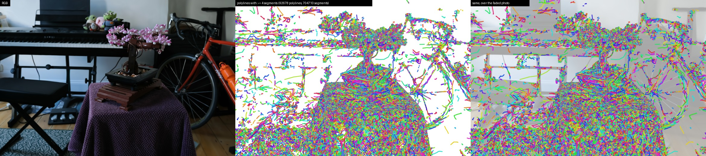
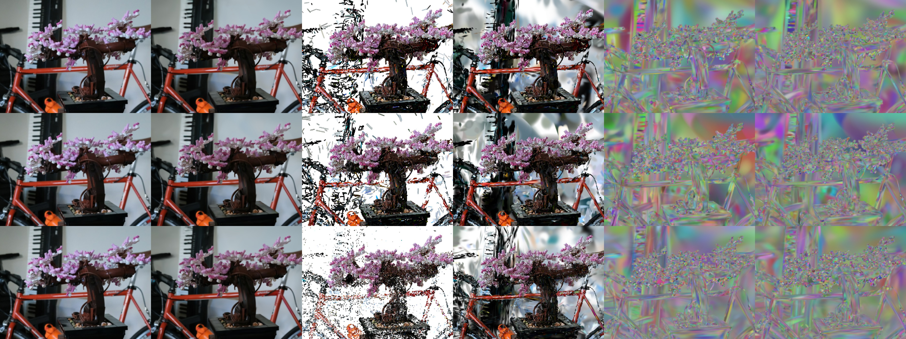
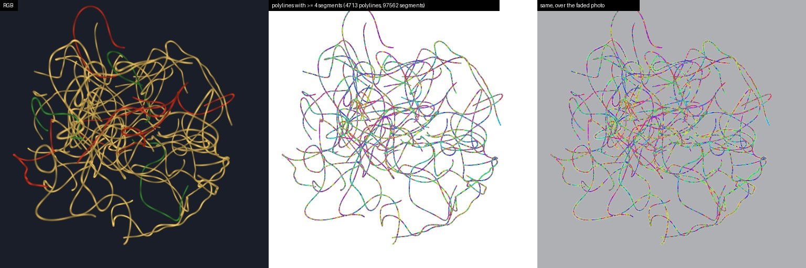

<h1 align="center">🍝 Spaghetti Splatting</h1>

<p align="center">
  <b>Unofficial PyTorch / CUDA reimplementation of</b><br>
  <i>Spaghetti Splatting: Differentiating Curvilinear Dirac Masses via Convolution</i><br>
  <sub>George Shramko, Shrisudhan Govindarajan, Rudy Lam, Yizheng Xie, Daniel Rebain, David B. Lindell, Andrea Tagliasacchi</sub>
</p>

<p align="center">
  <a href="#installation">Installation</a> ·
  <a href="#usage">Usage</a> ·
  <a href="#results">Results</a> ·
  <a href="#implementation-notes">Implementation notes</a> ·
  <a href="#citation">Citation</a>
</p>

<p align="center"></p>
<p align="center"><sub>
  Dirac measure of the primitives (cf. paper Fig. 3), bonsai test view DSCF5589. <b>Left:</b> point primitives
  (3DGS-MCMC-style baseline, same code base) are dots. <b>Middle:</b> our RGB render. <b>Right:</b> our segments form
  strokes that follow edges (bicycle, piano, walls). Ours uses the long-segment setting from the
  <a href="#mip-nerf-360-bonsai">bonsai table</a>; every primitive is drawn as a 0.15 px line with the same alpha.
</sub></p>

> [!IMPORTANT]
> This is **not** the authors' code and is not affiliated with them. It was written from the paper alone (the
> supplementary material was not available), so some details are my own derivations or choices; all of them are
> listed under [Implementation notes](#implementation-notes). Numbers below come from this implementation, **not** from
> the paper. Please use the official code once the authors release it.

## Highlights

- **Segments as primitives.** Segment Dirac measure ⊛ Gaussian or Beta kernel, organised as polylines with shared vertices.
- **Closed-form rendering.** Exact ray integral of a Gaussian-convolved segment (Eq. 17–19) and a screen-space version
  of the same form, with a perspective-correct segment parameter.
- **Hand-written CUDA rasterizer.** Tile-based forward and analytic backward, checked against a float64 reference
  (forward ≤ 8e-7, backward ≤ 2e-5 relative error).
- **Strict superset of 3DGS.** A zero-length segment (a = b) reproduces gsplat's 3DGS projection numerically.
- **Full training recipe of the paper.** 3DGS-MCMC relocation with midpoint split and cloning, polyline merging,
  attraction loss, Mip-Splatting filters, and the Table 1 ablation on a synthetic strand scene.

## What is implemented

| Paper | Status | Where |
|---|:-:|---|
| Segment Dirac measure ⊛ kernel, polylines with shared vertices (Sec. 3.2) | ✅ | `spaghetti/model.py` |
| Closed-form ray integral of a Gaussian-convolved segment (Eq. 17–19, erf) | ✅ exact 3D + screen space | `spaghetti/reference.py`, `csrc/spaghetti.cu` |
| Beta kernel (DBS-style), anisotropic | ✅ 8-pt Gauss–Legendre on the exact support | `csrc/spaghetti.cu` |
| EWA linearised at the segment midpoint, scaled by inverse depth (Sec. 3.4) | ✅ own derivation, [below](#screen-space-segment-integral) | `spaghetti/render.py` |
| Tile-based CUDA rasterizer, forward + hand-derived backward | ✅ | `csrc/spaghetti.cu` |
| Mip-Splatting 3D + 2D filters (Sec. 3.5) | ✅ | `model.compute_filter3d`, `render.project_segments` |
| Exact subdivision (α = 1 − e^{−τ}, pieces inherit the density per unit length) | ✅ τ conserved to 8e-7 | `model.spawn` |
| 3DGS-MCMC relocation: long segments split at the midpoint, short ones cloned (Fig. 6) | ✅ | `model.spawn / relocate / grow` |
| Polyline merging + attraction loss (Sec. 3.6) | ✅ own formulation | `model.merge_endpoints / attraction_loss` |
| L1 + D-SSIM + λ₁ L_MCMC + λ₂ L_connect (Eq. 20) | ✅ | `train.py` |
| a = b ⇒ 3DGS | ✅ matches gsplat | `tests/` |
| Spherical Voronoi (SV8) appearance | ❌ SH degree 3 instead | |
| Shelly / Fuzzy / GeomHair experiments, official baselines | ❌ | |
| Physics simulation of the strands | ❌ | |

## Results

All runs use the same code, rasterizer and MCMC settings and train for 30k iterations. *Points* are zero-length
segments (a = b), i.e. a 3DGS-MCMC-style baseline inside this code base (not the official 3DGS-MCMC).
LPIPS uses VGG with inputs mapped to [−1, 1].

### Mip-NeRF 360: bonsai

<sub>images_2, every 8th view held out, cap 1M primitives</sub>

| Method | PSNR ↑ | SSIM ↑ | LPIPS ↓ | mean polyline size |
|---|:-:|:-:|:-:|:-:|
| Points | **32.19** | 0.943 | 0.260 | 1.00 |
| Ours, Gaussian kernel | 32.01 | 0.942 | 0.262 | 3.66 |
| Ours, Beta kernel | 32.09 | **0.944** | 0.256 | 4.27 |
| Ours, Gaussian kernel, long-segment setting ¹ | 31.98 | 0.943 | **0.253** | 1.40 |

<sub>¹ `--split_len_factor 10 --scale_reg 0.3 --init_seg_len 1.5`: fewer midpoint splits, a stronger scale
regulariser and longer initial segments. Same model and training recipe, only hyper-parameters differ; this run is
used for the sketch at the top.</sub>

On a general scene all variants are within about 0.2 dB, consistent with the paper's claim of competitive
reconstruction.

<p align="center"></p>
<p align="center"><sub>
  Where is the spaghetti? One colour per connected polyline (polylines with ≥ 4 segments, 70% of the 1M segments).
  The noodles follow the bicycle spokes, rim and frame and the piano stand.
</sub></p>

<details>
<summary><b>More bonsai views</b> (Gaussian / Beta / points)</summary>
<br>
<p align="center"></p>
<p align="center"><sub>
  Rows: ours (Gaussian) · ours (Beta) · points. Columns: ground truth · render · strokes (each segment drawn as a
  0.35 px line in its colour) · shrunk kernels (×0.3) · one colour per polyline · one colour per primitive.
</sub></p>
</details>

### Synthetic spaghetti

<sub>`scripts/make_synthetic.py`: 48 thin coloured strands rendered with gsplat as an independent renderer;
112 / 16 train / test views at 512², cap 100k.</sub>

<p align="center"></p>
<p align="center"><sub>
  <b>Left:</b> points draw each strand as a dotted line. <b>Middle:</b> our render. <b>Right:</b> our segments form
  continuous curves.
</sub></p>

| Method | PSNR ↑ | LPIPS ↓ | strand F1 ↑ | 1-polyline cover ↑ | mean / max polyline size |
|---|:-:|:-:|:-:|:-:|:-:|
| Points | 43.46 | 0.0019 | 0.934 | 0.015 | 1 / 1 |
| Ours, Gaussian | **49.47** | **0.00044** | **0.994** | 0.058 | 16.9 / 149 |
| Ours, Beta | 49.06 | 0.00048 | 0.990 | **0.065** | 22.9 / 225 |

<sub>Strand F1 follows Sec. 4.2 (distance and tangent-angle thresholds; here 0.003 = 0.5 strand radius and 10°).
1-polyline cover = fraction of a GT strand covered by the single predicted polyline that matches most of it
(within 1 strand radius).</sub>

<p align="center"></p>
<p align="center"><sub>
  One colour per connected polyline: 97.6% of the segments belong to polylines with ≥ 4 segments (longest: 149).
  A single GT strand is still recovered as several polylines (the colour changes along a strand).
</sub></p>

### Ablation (cf. paper Table 1)

<sub>Synthetic scene, Gaussian kernel.</sub>

| Setting | PSNR ↑ | strand F1 ↑ | 1-polyline cover ↑ | mean / max polyline size |
|---|:-:|:-:|:-:|:-:|
| w/o midpoint split | 49.03 | 0.927 | 0.027 | 4.96 / 41 |
| w/o segment cloning | 49.07 | 0.984 | **0.089** | 30.5 / 305 |
| w/o polyline merging | 49.33 | **0.995** | 0.015 | 1.35 / 10 |
| w/o attraction loss | 49.43 | 0.991 | 0.029 | 4.38 / 43 |
| **full** | **49.47** | 0.994 | 0.058 | 16.9 / 149 |

As in the paper, merging and attraction barely change PSNR but determine connectivity.

## Installation

Requires an NVIDIA GPU, PyTorch with CUDA, and an `nvcc` matching your PyTorch CUDA version (Blackwell GPUs need
CUDA ≥ 12.8). The rasterizer is JIT-compiled on first import (`spaghetti/csrc/build`).

```bash
pip install -r requirements.txt
# optional: export CUDA_HOME=/path/to/cuda   (otherwise auto-detected from the python env or PATH)
python tests/test_spaghetti.py && python tests/test_model.py
```

## Usage

```bash
# data
python scripts/fetch_mipnerf360.py --scene bonsai --images images_2 --out data/360_v2   # one scene via HTTP range requests
python scripts/make_synthetic.py --out data/synth_spaghetti                            # synthetic strands (needs gsplat)

# training + evaluation (metrics.json and test renders in runs/<name>/)
python train.py --data data/360_v2/bonsai --images images_2 --out runs/bonsai_gauss --kernel gaussian
python train.py --data data/synth_spaghetti --type synthetic --cap 100000 --out runs/synth_beta --kernel beta
python train.py ... --points                                     # zero-length segments (point baseline)
python train.py ... --no_split | --no_clone | --no_merge | --no_attract   # Table 1 ablation
python train.py --data data/360_v2/bonsai --images images_2 --out runs/bonsai_long --kernel gaussian \
    --split_len_factor 10 --scale_reg 0.3 --init_seg_len 1.5    # long-segment setting (sketch at the top)

# analysis / figures
python scripts/eval_strands.py  --run runs/synth_gauss           # strand F1 + 1-polyline cover
python scripts/vis_sketch.py    --run runs/bonsai_long --data data/360_v2/bonsai --view 3 --out figures/sketch \
    --alpha_mode const --const_alpha 0.35 --width_px 0.15 --darken 0.85   # paper-like sketch (view 3 = DSCF5589)
python scripts/vis_spaghetti.py --run runs/bonsai_gauss --data data/360_v2/bonsai --view 3 --out figures/noodles
python scripts/vis_primitives.py --runs runs/bonsai_gauss runs/bonsai_points --data data/360_v2/bonsai --views 0 --out figures/bonsai
bash scripts/run_experiments.sh                                  # all experiments above (edit the GPU ids inside)
```

## Implementation notes

### Screen-space segment integral

Linearise EWA at the 3D midpoint of the segment and let the 2D covariance scale with inverse depth along it,
Σ(λ) = (z_m / z(λ))² Σ_m. With g₀ = (p − p_a)·z_a/z_m, g₁ = (p − p_b)·z_b/z_m and Q = ½ Σ_m⁻¹, the Jacobian of the
perspective re-parameterisation cancels exactly and

$$\tau(p) = \rho \int_0^1 e^{-\lVert g_0 + \lambda (g_1 - g_0) \rVert_Q^2}\, d\lambda
= \rho\, e^{-E}\, \frac{\sqrt{\pi}}{2\kappa} \big[\operatorname{erf}(A) + \operatorname{erf}(\kappa - A)\big],$$

the same form as Eq. 19, with P = g₀ᵀQg₀, R = (g₁ − g₀)ᵀQg₀, K = κ² = ‖g₁ − g₀‖²_Q, A = −R/κ and E = P − A².
λ is the 3D segment parameter (perspective-correct), a = b gives the 3DGS kernel exactly, and the error with respect to
the exact 3D ray integral is ≤ 1.1% of the peak in the tests. E and q(1) are evaluated from vectors to avoid float32
cancellation for long, thin segments.

### Choices not specified in the paper

1. **Density per unit kernel length.** Eq. 6 gives every segment unit mass, which, trained naively, makes the
   optimiser shrink segments to points (the lateral optical depth decays as 1/length). Following the paper's
   *exact subdivision* argument (pieces inherit the density per unit length), the density is parameterised as
   ρ_eff = softplus(x)·(1 + L/(√(2π) σ_along)). a = b still gives 3DGS exactly, the peak alpha across a long segment
   is ≈ sigmoid(x) independent of its length, and splits and clones conserve Σρ_eff exactly.
2. **MCMC noise.** The 3DGS-MCMC SGLD step (Σ·ε·noise_lr·lr) applied to individual endpoints stretches segments into
   scene-sized streaks (a chain's shared vertex gets averaged noise, a free end the full kick). It is applied as a
   rigid translation of isolated segments only. Near plane 0.2 as in 3DGS.
3. **L_MCMC only on primitives that received a photometric gradient.** At initialisation most primitives are fully
   occluded (zero photometric gradient); Adam then normalises the tiny regulariser into full-lr steps and ~97% of
   them die within 400 iterations, independently of the regulariser weight. Primitives that contributed to no
   training view for one epoch are relocated as dead.
4. **Merging and attraction.** Degree-1 endpoints of *different* polylines are merged (mutual nearest neighbours)
   within 0.5 kernel σ, only if the segments continue each other (point away from each other); the attraction loss
   pulls such endpoints within 3σ (distance / σ). Both run after relocation stops (last 5k iterations).
5. **Split pieces stay connected** (shared midpoint vertex), as in Fig. 6. Table 1 reports component size 1.00
   without merging, which suggests otherwise; the paper is ambiguous here.

### Validation

```bash
python tests/test_spaghetti.py && python tests/test_model.py
```

| Check | Result |
|---|---|
| Eq. 17–19 closed form vs. brute-force double integral | rel. err 1e-5 |
| Exact subdivision in 3D (τ conserved) | 1.6e-14; through `model.spawn` 8e-7 |
| CUDA forward vs. float64 dense reference | 8e-7 (Gaussian), 5e-7 (Beta) |
| CUDA backward vs. float64 autograd (all inputs) | rel. err ≤ 2e-5 |
| a = b projection vs. gsplat (3DGS) | means 3e-5 px, conic 7e-7, Mip compensation 2e-7 |
| Screen-space EWA vs. exact 3D ray integral | ≤ 1.1% of peak |

## Limitations

- Only one Mip-NeRF 360 scene and a synthetic strand scene were evaluated. Shelly, Fuzzy, GeomHair, the Spherical
  Voronoi appearance model and the official baselines are missing.
- The Beta kernel uses quadrature (the paper's closed form is in its supplementary material).
- With the default settings, flat, texture-less regions end up covered by a few very wide kernels, so the
  Dirac-measure view of walls is sparser than in the paper's Fig. 3. The long-segment setting gets closer.
- FPS numbers are not comparable to the paper (different GPU).

## Citation

Please cite the original paper:

```bibtex
@article{shramko2026spaghetti,
  title   = {Spaghetti Splatting: Differentiating Curvilinear Dirac Masses via Convolution},
  author  = {Shramko, George and Govindarajan, Shrisudhan and Lam, Rudy and Xie, Yizheng and
             Rebain, Daniel and Lindell, David B. and Tagliasacchi, Andrea},
  year    = {2026}
}
```

## Acknowledgements

Builds on the ideas of 3D Gaussian Splatting, 3DGS-MCMC, Mip-Splatting and Deformable Beta Splatting.
[gsplat](https://github.com/nerfstudio-project/gsplat) is used in the tests (projection parity) and to render the
synthetic ground truth. No code from the official 3DGS repository is included.

## License

The code in this repository is released under the MIT License (see `LICENSE`). Datasets keep their own licenses and
are not redistributed.
